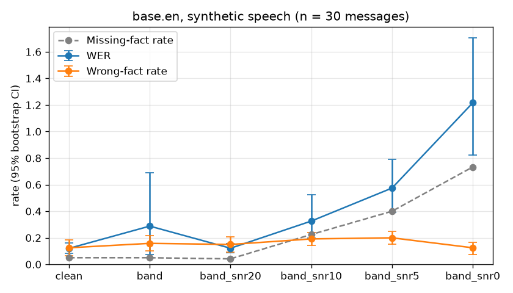

# Fluent but wrong: when speech recognition loses safety-critical facts in noisy radio messages

[](https://github.com/HojjatKamyabi/asr-radio-eval/actions/workflows/ci.yml)

With Whisper `base.en`, WER rises tenfold from clean speech (0.12) to a 0 dB channel (1.22). Over the same range the share of wrong safety-critical facts barely moves: it is 12.5% at both ends and never above 20.0%. Noise mostly turns facts into missing ones (5.0% missing on clean speech, 73.3% at 0 dB).

## Why it matters

An average WER can hide errors in the few words that matter. In a distress call those words are the vessel name, the position, the nature of distress and the number of persons on board. A missing fact is a nuisance: the operator notices and asks again. A wrong fact is dangerous because it looks plausible. "Two five persons" becomes "to 5 persons", and "four eight minutes" becomes "for eight minutes", which is 08 instead of 48. This small demonstration asks a question that applies to any AI output used downstream: does the overall score show whether the information you need survived?

## Results



Thirty synthetic messages, so 120 facts per condition. CIs are 95% bootstrap intervals over messages. Fact rates are shares of all facts. The numbers come from `results/<model>/synthetic/summary.csv`.

**tiny.en**

| Condition | WER [95% CI] | CER | Wrong-fact rate [95% CI] | Missing-fact rate |
|---|---|---|---|---|
| clean | 0.35 [0.13, 0.75] | 0.18 | 17.5% [12.5, 22.5] | 7.5% |
| band | 0.21 [0.17, 0.25] | 0.09 | 15.0% [10.8, 20.0] | 5.8% |
| band_snr20 | 0.29 [0.25, 0.32] | 0.14 | 15.8% [10.0, 21.7] | 10.0% |
| band_snr10 | 1.25 [0.58, 2.10] | 0.86 | 19.2% [13.3, 25.0] | 43.3% |
| band_snr5 | 1.14 [0.68, 1.79] | 0.80 | 15.8% [10.8, 20.8] | 57.5% |
| band_snr0 | 1.04 [0.83, 1.32] | 0.66 | 18.3% [13.3, 24.2] | 74.2% |

**base.en**

| Condition | WER [95% CI] | CER | Wrong-fact rate [95% CI] | Missing-fact rate |
|---|---|---|---|---|
| clean | 0.12 [0.08, 0.16] | 0.06 | 12.5% [6.7, 18.3] | 5.0% |
| band | 0.29 [0.07, 0.69] | 0.17 | 15.8% [10.0, 21.7] | 5.0% |
| band_snr20 | 0.12 [0.09, 0.16] | 0.06 | 15.0% [9.2, 20.8] | 4.2% |
| band_snr10 | 0.33 [0.20, 0.52] | 0.17 | 19.2% [14.2, 24.2] | 22.5% |
| band_snr5 | 0.57 [0.39, 0.79] | 0.37 | 20.0% [15.0, 25.0] | 40.0% |
| band_snr0 | 1.22 [0.82, 1.71] | 0.87 | 12.5% [7.5, 16.7] | 73.3% |

**What the numbers show.**
- **WER does not track wrong facts.** Wrong facts appear at every noise level, including clean speech: 12.5% for `base.en` at WER 0.12. Their rate stays in a narrow band (12.5% to 20.0% for `base.en`) while WER varies tenfold. What WER does track is the missing-fact rate.
- **Corpus WER is fragile.** A single clip stuck in a repetition loop can dominate it. `base.en` on clip 12 (`band`) appends a 224-word loop, giving WER 6.11, yet three of its four facts are correct. Such loops explain the wide CIs and the non-monotone WER for `tiny.en` on `clean` and for `base.en` on `band`.
- **Vessel names and positions carry most wrong facts.** Distress type was never wrong. Many vessel errors are spelling variants of less common words ("Gannett" for "Gannet", "Herron" for "Heron"), which a strict match counts as wrong (see `per_clip.csv`).

**Hallucinations on noise-only clips** (band-passed noise, no speech): `tiny.en` produced text on 0 of 30 clips (0.0%). `base.en` produced text on 7 of 30 (23.3%): "you" six times and one looping sentence, both listed in `hallucinations.csv`.

**RQ2 (synthetic vs real speech)** was not run: no real recordings were made. The scripts pick up `data/real/<id>.wav` automatically if added.

## Quickstart

```bash
git clone https://github.com/HojjatKamyabi/asr-radio-eval.git && cd asr-radio-eval
python3.11 -m venv .venv && source .venv/bin/activate   # Windows: .venv\Scripts\activate
pip install -r requirements.txt
python scripts/run_eval.py                    # tiny.en, a few minutes on CPU
python scripts/run_eval.py --model base.en
pytest                                        # pytest -m "not slow" skips the model download
uvicorn asr_eval.api:app --port 8000
curl -F file=@data/synthetic/01.flac -F "reference=Mayday, mayday, mayday." localhost:8000/transcribe
docker build -t asr-radio-eval . && docker run -p 8000:8000 asr-radio-eval
```

Regenerating the audio is optional and needs Piper; see [data/README.md](data/README.md).

## Method

- **Messages.** There are 30 messages from one MAYDAY-style template (`scripts/make_messages.py`, seed 42), so every fact is known by construction. The template is "Mayday" three times, "this is" plus the vessel name three times, position, nature of distress, persons on board, "over". Slots:
  - vessel: a fictional two-word name;
  - position: 53 to 55° N, 6 to 9° E, in degrees and minutes;
  - distress: fire, flooding, collision, grounding or man overboard;
  - persons: 2 to 25.
  
  Numbers are spoken digit by digit.
- **Speech.** Piper TTS with three public-domain voices (US female, US male, GB female), assigned round-robin. Audio is 16 kHz mono FLAC.
- **Channel.**
  - `band`: 4th-order Butterworth band-pass, 300 to 3000 Hz, zero-phase.
  - `band_snrX`: band plus white Gaussian noise at X dB SNR, relative to the band-passed speech.
  - `noise_only`: band-passed noise at the same power, with no speech.
  
  Noise seeds are the clip ids.
- **ASR.** faster-whisper `tiny.en` and `base.en` on CPU, int8, English, greedy decoding (beam 1, temperature 0), no conditioning on previous text, no VAD.
- **Normalization** is applied to reference and hypothesis alike: lowercase, punctuation removed, digits spelled as words ("54" becomes "five four"), whitespace collapsed.
- **Fact extraction** uses deterministic rules (`asr_eval/extract.py`):
  - vessel: the most frequent word pair after "this is";
  - position: digit runs after "position";
  - distress: keyword patterns;
  - persons: the digits before "persons".
  
  Each fact is scored *correct*, *missing* (not found) or *wrong* (a different value). A position counts as correct only if all four numbers match. A position outside valid ranges (minutes ≥ 60 and so on) counts as missing, because an operator would notice it. The extractor scores 100% on all 30 reference texts (`tests/test_extract.py`), so every fact error comes from speech recognition.
- **Metrics.**
  - WER = (S + D + I) / N, summed over all messages of a condition (corpus level). CER is the same on characters.
  - Wrong-fact rate = wrong facts / all facts (4 per message). Missing-fact rate is defined the same way.
  - 95% CIs come from 1000 bootstrap resamples of messages, seed 0.
  - Hallucination rate = share of noise-only clips with a non-empty normalized transcript.

## Reproducibility

The following are fixed:
- `requirements.txt`;
- the message seed, noise seeds and bootstrap seed;
- the model names and deterministic decoding.

Each run writes `run_info.json` with the model, ASR settings, seeds, package versions and date. The full evaluation was run twice from a fresh virtual environment with an empty model cache, and `summary.csv`, `per_clip.csv` and `hallucinations.csv` were byte-identical for both models. The results were produced on Windows. Linux (CI, Docker) can give slightly different transcripts for some clips; for example, clip 01 comes out with "purses" instead of "persons". The audio itself is committed because Piper synthesis is not deterministic.

## Limitations

- **Synthetic speech** is cleaner and more regular than a stressed human voice.
- **The channel is simulated**: band-pass and white noise only. There is no FM demodulation, squelch, clipping, fading or interference. This is not real VHF radio.
- **One fixed template and a rule-based extractor.** Real messages vary in wording and order and would be harder.
- **Strict matching** counts spelling variants of names as wrong.
- **English only, 30 messages**, so the confidence intervals are wide.
- **RQ2 (real speech) was not run.**

## Possible next steps

- Real or German maritime radio speech.
- A learned entity extractor compared with the rules.
- The wrong-fact rate as a regression test when swapping ASR models.

## Data, licences and attribution

- The code is MIT licensed (`LICENSE`).
- The audio was made with [Piper](https://github.com/OHF-Voice/piper1-gpl) (`piper-tts`, GPL-3.0), run as an external program and not imported or distributed here.
- The voices are `en_US-ljspeech-medium` (LJ Speech, public domain), `en_US-norman-medium` and `en_GB-cori-medium` (LibriVox, public domain). Details are in [data/README.md](data/README.md).
- All messages, vessel names and positions are fictional.
- Speech recognition uses OpenAI Whisper models (MIT) via faster-whisper.
